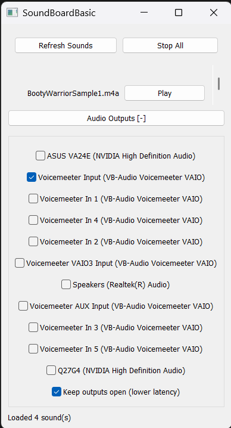

# SoundBoardBasic

A small, portable Windows soundboard that plays files from a `sounds` folder
beside the app and routes them to one or more selected Windows audio outputs.
Trigger multiple clips at once, including repeated instances of the same sound.



## Why this exists

Sound effects are often scattered across media players or tied to a single
output device. SoundBoardBasic keeps a folder of clips ready to trigger and
lets each clip reach multiple outputs at once, such as headphones and a virtual
audio cable for a call, stream, or game.

## Features

- Scan the adjacent `sounds` folder and list supported files alphabetically,
  with a **Play** button for each sound.
- **Refresh Sounds** rescans the folder without restarting the app.
- Play several sounds simultaneously, including overlapping plays of the same
  file.
- **Stop All** immediately silences active sounds.
- Select any combination of active Windows playback devices.
- Collapse or expand the **Audio Outputs** section to make more room for the
  sound list.
- Keep output streams open between plays for lower latency.
- Supported formats: WAV, MP3, FLAC, OGG/Vorbis (`.ogg`, `.oga`), and
  AAC-encoded M4A (`.m4a`).
- Portable settings: output selections, keep-open preference, and window bounds
  are saved to `soundboard.json` beside the executable.
- No installer, registry entries, cgo, or external codec binaries.

## Requirements

- Windows 10 or 11.
- An active Windows playback device.
- Windows Media Foundation's AAC decoder for AAC-encoded M4A files.

## Using the app

1. Launch `soundboard.exe`. The app creates a `sounds` folder beside itself if
   one does not exist.
2. Put audio files directly in `sounds` (subfolders are not scanned).
3. Click **Refresh Sounds** to show newly added files.
4. Expand **Audio Outputs** if needed, then select one or more devices. Hover
   over the section header for the supported-format list.
5. Click a sound's **Play** button. Click **Stop All** to silence all sounds.

The app remembers output selections, the keep-open option, and window position
and size in `soundboard.json`.

## Building from source

```powershell
.\build.ps1
```

The script builds `soundboard.exe` with Go's `windowsgui` subsystem, so
launching it from Explorer does not open a command prompt. Startup errors are
shown in a Windows message box. No cgo or MinGW/MSVC toolchain is required.

The Windows Common Controls v6 manifest is embedded from
[`app.manifest`](app.manifest) via [`rsrc_windows_amd64.syso`](rsrc_windows_amd64.syso).
If you change the manifest, regenerate the resource from the project directory:

```powershell
go install github.com/akavel/rsrc@latest
rsrc -manifest app.manifest -o rsrc_windows_amd64.syso
```

## How it works

1. The app scans the top level of `sounds` and decodes a clip on first play;
   decoded PCM is cached for quick repeat playback.
2. The audio engine resamples each clip to the native format of every selected
   output device.
3. A mixer per device sums concurrent sounds into a continuous WASAPI shared-
   mode stream, so overlapping playback works on a single device as well as
   across multiple devices.
4. AAC in M4A files is decoded to PCM using the Windows Media Foundation Source
   Reader and the system AAC decoder. Since the Source Reader opens a path, the
   decoder temporarily writes the file to disk and removes it after decoding.

See [`implementation-plan.md`](implementation-plan.md) for the detailed design
and verification notes.

## Known limitations

- Windows-only; M4A/AAC decoding depends on the Windows Media Foundation AAC
  decoder being available.
- The sounds folder is refreshed manually; filesystem changes are not watched.
- Only files directly inside `sounds` are listed; subfolders are ignored.
- Audio devices are enumerated at startup. Restart the app after connecting or
  enabling a device.
- Channel conversion uses simple averaging and duplication, not a surround
  mixing matrix.

## License

No license has been chosen yet for this project.
